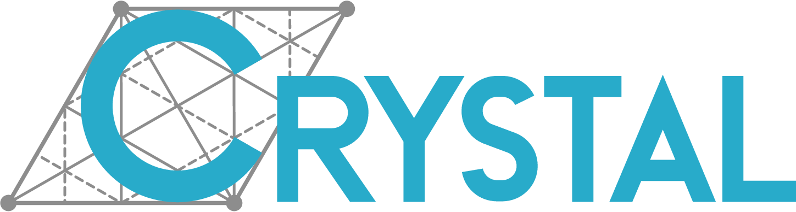

<p align="center">
  
</p>

<p align="center">
  A Python framework for the <b>CRYSTAL</b> quantum-chemistry code: it reads
  what a calculation writes and plots the properties it returns.
</p>

<p align="center">
  <a href="https://crystaldevs.github.io/CRYSTALClear/"><b>Documentation</b></a>
</p>

<p align="center">
  <a href="https://pypi.org/project/CRYSTALClear/"></a>
  <a href="https://github.com/crystaldevs/CRYSTALClear/actions/workflows/documentation.yml"></a>
  
  
  
  
</p>

## Installation

Public releases are distributed through PyPI. In an environment of its own:

```sh
conda create --name crystalclear python=3.9 && conda activate crystalclear
pip install CRYSTALClear
```

pymatgen, numpy, mendeleev and ase are installed with it if not already
present.

## What it does

- Band structures and densities of states
- Elastic properties: Young and shear moduli, linear compressibility, Poisson ratio
- Harmonic and anharmonic IR and Raman spectra
- Electron densities and topological analysis of their Laplacian
- Transport properties
- Extraction of information from CRYSTAL `.out` files

The [documentation](https://crystaldevs.github.io/CRYSTALClear/) describes each
of these in turn.

## Usage

To use any of the features of the package, first build a CRYSTAL object through
the `crystal_io` module. Three classes are available, for different uses:

1. **Crystal_output**: extracts information, and builds the objects to plot,
   from any `.out` file of the CRYSTAL package.
2. **Properties_output**: builds the objects to plot any of the quantities
   stored in the `.DAT` and `.f25` files written by the PROPERTIES module.
3. **External_unit**: builds the objects to plot any of the quantities stored
   in the `.DAT` and `.f25` files written by CRYSTAL.

```py
from CRYSTALClear.crystal_io import class
# Crystal_output
data = class(file).function(*args, **kwargs)
# Properties_output and External_unit
data = class().function(file)
```

Once the object is built, the desired plot is drawn with the functions of the
`plot` module:

```py
import CRYSTALClear.plot as CCplt
CCplt.function(data, *args, **kwargs)
```

Each function returns one (or a list of) [matplotlib](https://matplotlib.org/)
objects, which can be modified as any other plot made with the library.

## Contributing

Contributions are what make the open source community such an amazing place to
be, learn, inspire, and create. Any contributions you make are **greatly
appreciated**.

1. Fork the project
2. Create your feature branch (`git checkout -b feature/AmazingFeature`)
3. Commit your changes (`git commit -m 'Add some AmazingFeature'`)
4. Push to the branch (`git push origin feature/AmazingFeature`)
5. Open a pull request

## License

Distributed under the MIT License. See [LICENSE.txt](LICENSE.txt).

## Acknowledgements

Forked from [CRYSTALpytools](https://github.com/crystal-code-tools/CRYSTALpytools).
[CRYSTALLine](https://github.com/crystaldevs/CRYSTALLine), the desktop program
for CRYSTAL structures, is built on it.

## Contact

- Website: https://www.crystal.unito.it
- Email: crystalunito@gmail.com
- Instagram: [@crystaldevs](https://www.instagram.com/crystaldevs/)
